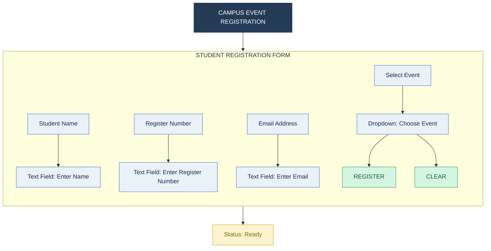
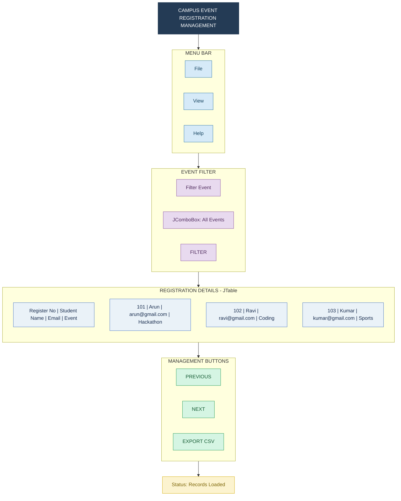
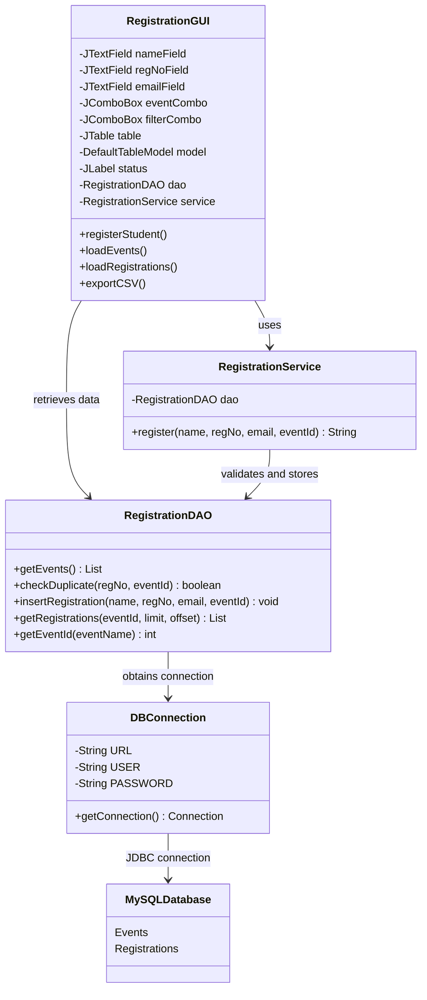

Campus Event Registration Desktop Application

Stage 1 – Interpret the Problem 

Aim:

To design and implement a Campus Event Registration Desktop Application using Java Swing and MySQL JDBC that allows students to register for events and enables the committee to view, filter and export registrations.

1. Identify the Users

- Students: Enter their details and register for campus events.

- Committee Members: View registrations, filter them by event and export registration details.

- Administrator: Maintains event information and database records.

2. Identify the Screens

- Registration Screen:

  - Student name.

  - Register number.

  - Email address.

  - Event selection.

  - Register button.

- Registration Management Screen:

  - Displays all registrations using JTable.

  - Provides event filtering.

  - Provides refresh and export options.

- Confirmation Dialog:

  - Displays successful registration messages.

  - Displays errors for invalid or duplicate registrations.
    
3. Identify the Data

- Student ID.

- Student name.

- Register number.

- Email address.

- Event ID.

- Event name.

- Registration date.

4. Identify the Rules

- Student name must not be empty.

- Register number must be valid.

- Email address must follow a valid format.

- An event must be selected.

- A student cannot register twice for the same event.

- Database operations must not freeze the GUI.

- Registration information must be stored in MySQL.

- The committee must be able to filter and export registration records.

5. Testable Requirements

- The application must accept valid student information.

- The application must reject empty or invalid input.

- The application must prevent duplicate registrations.

- The application must display all saved registrations.

- The application must filter registrations by event.

- The application must export registration records.

- The application must remain responsive during database operations.

Registration Screen Design

Screen components:
- Student Name: JTextField
- Register Number: JTextField
- Email Address: JTextField
- Select Event: JComboBox
- Register: JButton
- Clear: JButton
- Status: JLabel
2. Registration Management Screen
This screen represents the committee's interface for viewing, filtering and exporting student registrations.

Screen components:
- JFrame: Main application window.
- JMenuBar: Contains File, View and Help menus.
- JMenu: Organises menu options.
- JComboBox: Filters registrations by event.
- JTable: Displays registration records.
- JScrollPane: Provides scrolling for the table.
- JButton: Previous, Next, Export CSV and Filter.
- JLabel: Displays status messages.
C. Menu Bar

The application uses JMenuBar and JMenu.

- File:

  - Export Registrations.

  - Exit.

- View:

  - Refresh.

  - View All Registrations.

- Help:

  - About Application.

D. Event Flow Diagram

             START
               |
               v
       Open Registration GUI
               |
               v
        Enter Student Details
               |
               v
         Select Campus Event
               |
               v
        Click Register Button
               |
               v
         Validate Input
               |
          +----+----+
          |         |
        Invalid    Valid
          |         |
          v         v
      Show Error   Check Duplicate
                      |
                 +----+----+
                 |         |
              Duplicate  New Entry
                 |         |
                 v         v
             Show Error  Insert into
                         Database
                            |
                            v
                       Confirmation
                            |
                            v
                    View Registrations
                            |
                            v
                     Filter / Export
                            |
                            v
                           END

Explanation:

- The student enters the registration information.

- The application validates the input.

- The system checks whether the student has already registered for the selected event.

- If a duplicate exists, an error message is displayed.

- Otherwise, the registration is stored in MySQL.

- The committee can view, filter and export registration records.

Stage 2 – Identify the Critical Design Decisions 

1. Input Validation

- Input validation is performed in the service layer.

- Empty names, register numbers and email addresses are rejected.

- An event must be selected before registration.

- Invalid input displays a clear error message.

2. Duplicate Registration Checking

- Before inserting a registration, the service checks whether the register number and event ID already exist.

- A SQL query is used to check existing registrations.

- A UNIQUE constraint on (register_no, event_id) is also added to the database.

- This prevents duplicate entries even if two registration requests occur simultaneously.

3. Database Access

- JDBC is used to communicate with MySQL.

- PreparedStatement is used for parameterized queries.

- Database operations are performed in the DAO (Data Access Object) layer.

- Database connections and statements are closed using try-with-resources.

4. Preventing GUI Freezing

- Long-running database operations must not execute directly on the Event Dispatch Thread.

- SwingWorker is used to execute database operations in the background.

- The GUI remains responsive while data is loading.

- The done() method updates the GUI after background processing finishes.

5. Separation of Responsibilities

- GUI layer: Handles user interactions.

- Service layer: Performs validation and business rules.

- DAO layer: Performs JDBC database operations.

Stage 4 – Design the Classes and Handlers 

A. Class Diagram

B. Pseudocode for Register Action

BEGIN

    GET student name
   
    GET register number
    
    GET email
    
    GET selected event

    IF student name is empty THEN
        
        DISPLAY "Enter student name"
        
        STOP
    
    END IF

    IF register number is empty THEN
        
        DISPLAY "Enter register number"
        
        STOP
    
    END IF

    IF email is invalid THEN
       
        DISPLAY "Enter valid email"
        
        STOP
    
    END IF

    IF event is not selected THEN
    
        DISPLAY "Select an event"
        
        STOP
    
    END IF

    START BACKGROUND TASK

        CHECK whether student is already registered
        
        for the selected event

        IF duplicate exists THEN

            RETURN "Already registered"

        ELSE

            INSERT registration into database

            RETURN "Registration successful"

        END IF

    END BACKGROUND TASK

    DISPLAY RESULT

END

C. Pseudocode for Filter Action

BEGIN

    GET selected event

    START BACKGROUND TASK

        IF selected event is "All Events" THEN

            FETCH all registrations

        ELSE

            FETCH registrations belonging
            to selected event

        END IF

    END BACKGROUND TASK

    DISPLAY filtered records in JTable

ENDRequired MySQL JDBC Driver

To run the application, you need:

- Java JDK installed.

- MySQL Server installed and running.

- MySQL Connector/J JDBC driver.

- MySQL database and tables created.

- Correct database username and password.

Execution Order:

1. Open MySQL Workbench.

2. Execute database.sql.

3. Add MySQL Connector/J to your Java project's libraries.

4. Create the Java files:

   - DBConnection.java

   - RegistrationDAO.java

   - RegistrationService.java

   - RegistrationGUI.java

6. Enter your MySQL password in DBConnection.java.

7. Compile all four Java files.

8. Run RegistrationGUI.java.

Command-line compilation example:

If the MySQL Connector/J JAR is in the same folder:

Windows:

javac -cp ".;mysql-connector-j.jar" DBConnection.java RegistrationDAO.java RegistrationService.java RegistrationGUI.java

Run:
java -cp ".;mysql-connector-j.jar" RegistrationGUI

Replace mysql-connector-j.jar with the actual downloaded JAR filename.

7. Demonstrate Test Cases

Test Case 1 – Successful Registration

- Student Name: Arun

- Register Number: 101

- Email: arun@gmail.com

- Event: Hackathon

Expected Output:

Registration successful

Test Case 2 – Invalid Registration

- Student Name: Arun

- Register Number: 101

- Email: invalidemail

- Event: Hackathon

Expected Output:

Invalid email address

Test Case 3 – Duplicate Registration

- Student Name: Arun

- Register Number: 101

- Email: arun@gmail.com

- Event: Hackathon

Register the same student for the same event again.

Expected Output:

Already registered for this event

Test Case 4 – Event Filtering

- Select Hackathon in the Filter Event option.

- Click Filter.

Expected Output:

- Only Hackathon registrations are displayed.

Test Case 5 – Export Registrations

- Click Export CSV.

- Select a location to save the file.

- Open the generated CSV file.

Expected Output:

- The registration details are exported successfully.

Test Case 6 – Pagination

- Insert more than 20 registrations.

- Click Next to view the next page.

- Click Previous to return to the earlier page.

Expected Output:

- Registrations are loaded page by page.

- The GUI remains responsive during database loading.

Alternative Concept and Complexity Analysis

Alternative 1: Load All Registrations at Once

- Execute a SQL query to retrieve all 100,000 registrations.

- Store all retrieved records in memory.

- Add all records to the JTable.

- This requires more memory and may slow down the application.

- The GUI may become temporarily unresponsive if the operation is performed on the EDT.

Alternative 2: Pagination Using LIMIT and OFFSET with SwingWorker

- Retrieve only a limited number of records at a time.

- Use SQL LIMIT and OFFSET to fetch each page.

- Execute database operations using SwingWorker.

- Update the JTable after background processing completes.

- This reduces memory consumption and improves GUI responsiveness.

Example SQL Query:

SELECT *

FROM registrations

ORDER BY id

LIMIT 20 OFFSET 0;

For the next page:

SELECT *

FROM registrations

ORDER BY id

LIMIT 20 OFFSET 20;

Time Complexity:

- Loading all registrations:

  - All 100,000 records must be retrieved and processed.

  - Time complexity: O(n) for processing n records.

  - Database query time also depends on indexing, database execution and network transfer.

- Pagination:

  - Only 20 records are retrieved per page.

  - Processing one page requires O(p) time, where p is the page size.

  - Retrieving all records across all pages still requires processing O(n) records in total.

Space Complexity:

- Loading all registrations:

  - All 100,000 records are stored in memory.

  - Space complexity: O(n).

- Pagination:

  - Only one page of records is loaded at a time.

  - Space complexity: O(p), where p is the page size.

Effect on GUI Responsiveness:

- Loading all records at once can consume considerable memory and may make the window slow.

- Pagination retrieves smaller amounts of data.

- SwingWorker performs database operations in the background.

- Therefore, the user can continue interacting with the application while data is being loaded.

Conclusion:

Pagination using SQL LIMIT and OFFSET with SwingWorker is more suitable for a large registration system. It reduces memory usage, improves loading performance and keeps the GUI responsive. For very large datasets, indexed keyset pagination can also be considered to avoid the increasing scan cost of large OFFSET values.
